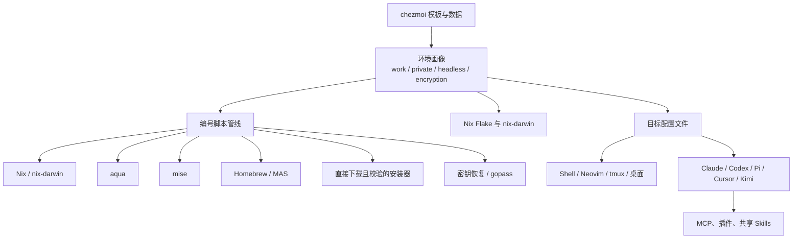

# signalridge/dotfiles 调研报告

> 调研日期：2026-10-14  
> 调研对象：[signalridge/dotfiles](https://github.com/signalridge/dotfiles) 默认分支 `main`

## 结论

这是一个面向作者个人工作站的、高投入度声明式配置仓库，不是通用 dotfiles 模板。核心技术路线成熟：`chezmoi` 编排、Nix 管理跨平台包、`nix-darwin` 管理 macOS、Homebrew/aqua/mise 补充生态缺口；但它对 AI Agent 采用明确的高权限策略，且配置面、供应链与首次引导复杂度都很高。

**适合作为架构参考或深度定制基线，不适合不经审查直接应用到工作机或含敏感代码的环境。**

## 调研范围

分析公开仓库的 README、核心配置、引导脚本、CI/安全工作流和近期提交；未执行安装或修改本机。

调研时仓库为公开、未归档状态，44 stars、4 forks、0 个开放 Issue；最新推送为 2026-10-13。

来源：[仓库元数据](https://api.github.com/repos/signalridge/dotfiles)、[README](https://github.com/signalridge/dotfiles/blob/main/README.md)。

## 项目定位与成熟度

| 项目 | 观察 |
|---|---|
| 定位 | macOS/Linux 个人开发环境，以 `chezmoi + Nix` 为主干，覆盖 Shell、编辑器、桌面自动化、密钥、AI Agent、MCP 与开发工具。 |
| 支持平台 | macOS 与 Linux；首次安装仅提供 `aarch64-darwin`、`aarch64-linux`、`x86_64-linux` 的 pinned Nix installer，新的 `x86_64-darwin` 安装会被拒绝。 |
| 维护自动化 | 每日调度依赖更新工作流；Dependabot 每日检查 GitHub Actions；近期提交连续更新 flake、aqua 包和版本锁。 |
| 质量门禁 | pre-commit 覆盖格式化、ShellCheck、Nix、Lua、YAML/TOML、拼写和 Gitleaks；CI 在 macOS/Linux 渲染模板并执行 `nix flake check --no-build`。 |
| 安全治理 | 有 `SECURITY.md`、私有漏洞报告入口、Gitleaks/Trivy/Zizmor 工作流，GitHub Actions 使用固定 commit SHA。 |
| 可再分发性 | 根目录没有 `LICENSE`；README 也明确要求不要在补充许可前把它视为可再分发项目。 |

来源：[README 的平台与 Profile 说明](https://github.com/signalridge/dotfiles/blob/main/README.md#support-and-profile-behavior)、[CI](https://github.com/signalridge/dotfiles/blob/main/.github/workflows/ci.yml)、[安全工作流](https://github.com/signalridge/dotfiles/blob/main/.github/workflows/security.yml)、[安全策略](https://github.com/signalridge/dotfiles/blob/main/SECURITY.md)。

## 架构



### 环境建模：chezmoi

- `.chezmoi.toml.tmpl` 首次运行收集 `work`、加密启用状态、身份、主机名、时区等数据。
- 对无 TTY、缺少关键配置的场景明确失败，避免默认把工作机错误当成私人机器，或生成包含“GitHub username”字样的损坏配置。
- `work` 派生出 `private = !work`；`headless` 控制 GUI、LaunchAgent 等目标文件；`useEncryption` 控制 SSH/gopass/密钥恢复路径。

### 依赖与系统配置

- Nix profile 管理跨平台软件；macOS 通过 `nix-darwin` 管理系统设置、Homebrew 集成和服务。
- Homebrew、aqua、mise、直接下载安装器共存，分别处理 GUI 软件、pin 的 CLI、运行时/语言工具、Cursor Agent/Paperlib/Azure Functions 等特殊软件。
- `versions.yaml` 集中保存关键安装器的版本与 SHA-256，例如 Nix、aqua、Cursor Agent、Paperlib、TPM。

### 编号执行管线

- 脚本从 `00` 到 `23`，包含 Nix、aqua、mise、gopass、MCP、AI 插件、LaunchAgent/systemd、终端主题等。
- 采用 `run_onchange`、`run_after` 与每周节流组合，减少不必要的重复安装，同时允许定期更新。

### AI 工具平台

- 同时管理 Claude Code、Codex CLI、Pi、Cursor Agent、Kimi Code、Antigravity CLI 与 aichat。
- 集中维护模型供应商、账号切换、MCP、Hooks、共享 Skills；Skills 位于 `~/.harnesses/skills`，按项目显式激活到各 Agent 目录。
- Claude/Codex 的配置用 `modify_` 脚本合并，保留运行时写入的状态，避免完整覆盖配置文件。

来源：[核心 chezmoi 模板](https://github.com/signalridge/dotfiles/blob/main/.chezmoi.toml.tmpl)、[Nix Flake 模板](https://github.com/signalridge/dotfiles/blob/main/nix-config/flake.nix.tmpl)、[外部 Skills/TPM 配置](https://github.com/signalridge/dotfiles/blob/main/.chezmoiexternal.toml.tmpl)、[README 的引导脚本表](https://github.com/signalridge/dotfiles/blob/main/README.md#bootstrap-flow-what-actually-runs)。

## 值得借鉴的设计

| 设计 | 价值 | 证据 |
|---|---|---|
| 无 TTY 时关键变量 fail-closed | 避免工作/私人画像、加密状态、身份信息被静默赋予危险默认值。 | [`.chezmoi.toml.tmpl`](https://github.com/signalridge/dotfiles/blob/main/.chezmoi.toml.tmpl) |
| 配置所有权分层 | `modify_` 合并保留 AI CLI 运行时状态；受管理键每次 apply 保持一致。 | [Claude 合并脚本](https://github.com/signalridge/dotfiles/blob/main/dot_claude/modify_settings.json.tmpl)、[Codex 合并脚本](https://github.com/signalridge/dotfiles/blob/main/dot_codex/modify_config.toml.tmpl) |
| 版本与校验集中化 | 对核心二进制下载保持版本 pin 和 SHA-256，降低直接下载的篡改风险。 | [`versions.yaml`](https://github.com/signalridge/dotfiles/blob/main/.chezmoidata/versions.yaml) |
| 将外部依赖和本地配置区分 | TPM 与共享 skills 走 chezmoi external，仓库自有配置仍保留在版本库中。 | [`.chezmoiexternal.toml.tmpl`](https://github.com/signalridge/dotfiles/blob/main/.chezmoiexternal.toml.tmpl) |
| CI 先渲染再检查 | 不是只检查原始模板，而是在 macOS/Linux 矩阵下渲染出 flake 后执行检查。 | [CI 工作流](https://github.com/signalridge/dotfiles/blob/main/.github/workflows/ci.yml) |
| GitHub Actions 供应链基础卫生 | `permissions: {}` 起始、任务级最小权限、Action 使用 SHA pin、历史 Gitleaks 扫描。 | [安全工作流](https://github.com/signalridge/dotfiles/blob/main/.github/workflows/security.yml) |
| 将本机差异留在未管理文件 | `~/.custom/local.sh` 最后加载，防止把机器局部需求污染声明式基线。 | [README：Shell 配置](https://github.com/signalridge/dotfiles/blob/main/README.md#shell-aliases-and-functions) |

## 风险与限制

### P0：不应直接用于不可信仓库或敏感工作机

AI Agent 默认权限极宽：

- Codex：`approval_policy = "never"`、`sandbox_mode = "danger-full-access"`，并继承全部 Shell 环境。
- Claude：`bypassPermissions`；尽管有 `sudo`、重启、部分 `rm -rf` 与 pip 安装规则，配置本身明确允许广泛 Shell 操作。
- README 同时声明 Cursor 为 unrestricted、Kimi 为 yolo、Antigravity 为 always-proceed/no sandbox。

这不是实现遗漏，而是作者公开声明的运行姿态。它与 Agent 可访问 SSH、gopass、MCP、浏览器或工作代码的组合风险很高。使用者应至少将工作与个人的 Agent 配置分离，并将默认模式改为按请求批准、工作区写入沙箱和最小化 MCP。

来源：[Codex 配置](https://github.com/signalridge/dotfiles/blob/main/dot_codex/modify_config.toml.tmpl)、[Claude 配置](https://github.com/signalridge/dotfiles/blob/main/dot_claude/modify_settings.json.tmpl)、[README：AI execution posture](https://github.com/signalridge/dotfiles/blob/main/README.md#ai-execution-posture)。

### P1：首次引导仍有未校验的远程执行环节

仓库 README 建议用户先下载并审阅本仓库的 `init.sh`，这是正确的；但该脚本在本机不存在 chezmoi 时仍执行：

```sh
sh -c "$(curl -fsLS --proto '=https' --tlsv1.2 https://get.chezmoi.io)"
```

该步骤没有 pin 或 checksum。之后的 Nix/aqua/Cursor 等核心下载大多有版本或校验约束，但这一步仍是启动信任链中的例外。高安全需求环境应预装经过组织验证的 chezmoi 二进制，或将 bootstrap 安装器同样固定版本并校验。

来源：[`init.sh`](https://github.com/signalridge/dotfiles/blob/main/init.sh)。

### P1：依赖管理层过多，维护成本和冲突面较大

Nix、nix-darwin、Homebrew、aqua、mise、chezmoi external、直接安装脚本共同管理系统。README 已清楚划分了所属范围，但实际排障仍需首先识别工具所有者，尤其是：

- 同一 CLI 可能在 Nix、aqua 或 mise 中存在；
- Homebrew 不具备 Nix lock 同级别的可复现性；
- `run_after` 的 MCP/插件同步会修改工具自身状态；
- 每日更新工作流产生多个依赖 PR，人工审查仍是必要控制点。

建议采用时保留这一所有权矩阵；不要再引入第五种包管理器，也不要跨层安装同一工具。

来源：[README：Package and Tool Management](https://github.com/signalridge/dotfiles/blob/main/README.md#package-and-tool-management)、[版本更新工作流](https://github.com/signalridge/dotfiles/blob/main/.github/workflows/update-versions.yml)、[aqua 更新工作流](https://github.com/signalridge/dotfiles/blob/main/.github/workflows/update-aqua-packages.yml)。

### P2：CI 证明“可渲染/可静态检查”，不证明完整装机可用

CI 执行 lint、模板渲染、`nix flake check --no-build` 和 flake checker；未执行真实 `chezmoi apply`、包安装、加密恢复、AI 插件/MCP 同步或 macOS 的 `darwin-rebuild switch`。这对个人配置仓库是合理的成本控制，但意味着首次安装与 OS 特定副作用仍主要依赖作者本机验证。

来源：[CI 工作流](https://github.com/signalridge/dotfiles/blob/main/.github/workflows/ci.yml)。

### P2：可复用性和合规边界有限

- 仓库自称 working configuration rather than generic starter template，内含个人默认值、私人机器软件与宽松的 AI 执行策略。
- 根目录无许可证，不能默认复制、分发或二次发布。
- 大量特定于作者的 AI 模型、第三方 API、gopass 目录、macOS GUI 工具、键盘/IME/窗口管理设置，使 fork 后的裁剪工作不可避免。

来源：[README：What This Repository Is](https://github.com/signalridge/dotfiles/blob/main/README.md#what-this-repository-is)、[README：License Status](https://github.com/signalridge/dotfiles/blob/main/README.md#license-status)。

## 采用建议

| 目标 | 建议 |
|---|---|
| 学习 chezmoi/Nix 组合 | 可直接研究：画像驱动模板、编号脚本、CI 渲染检查、版本 pin 和 `modify_` 合并策略都值得复用。 |
| 建立个人 macOS 开发环境 | 以新仓库重新建基线；优先保留 chezmoi、Nix、CI、Gitleaks，按需迁移 Shell/编辑器配置。不要先迁移全部 AI/MCP/Skills。 |
| 部署到工作机 | 不建议直接 apply。先删除或收紧所有 Agent 的无审批/无沙箱配置，隔离工作凭据，逐项审查 MCP、插件、LaunchAgent 和下载脚本。 |
| 用作团队标准环境 | 不适合原样采用。需要补许可证、定义受支持平台、降低个人偏好、建立二进制 provenance/审计策略，并将可选模块拆分为明确 profile。 |
| 提升供应链安全 | 预装/校验 chezmoi；保留已存在的 SHA pin；对自动生成的版本更新 PR 执行人工审查，不把“每日生成 PR”误认为“每日安全升级”。 |

## 总体判断

工程质量明显高于常见个人 dotfiles；它的主要问题不是缺少能力，而是能力与权限密度过高。最安全的使用方式是借鉴其配置编排和验证机制，按最小权限原则重新组装自己的配置集。
